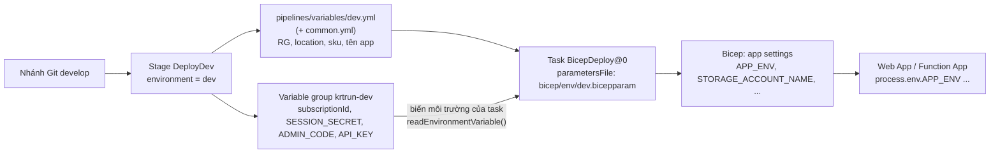
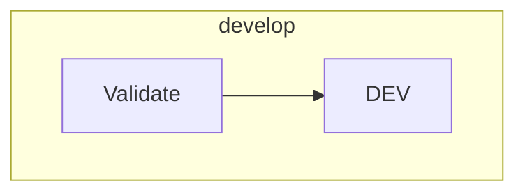
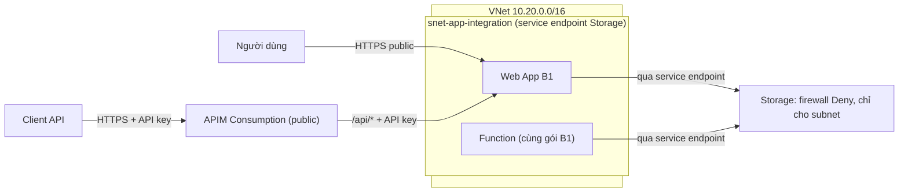

# KRT-run (repo `infra`) – Hướng dẫn

Repo này chứa **hạ tầng Azure** bằng **Bicep** và pipeline **provision** (Azure DevOps): VNet, App Service Plan + Web App (Node 22), Function App (chạy chung gói B1 với web), Storage (Blob/Queue/Table), APIM Consumption. Code ứng dụng và pipeline app-deploy nằm ở repo riêng `app`.

```
infra/
├── AGENTS.md
├── .cursor/rules/bicep.mdc
├── bicep/
│   ├── main.bicep
│   ├── modules/           # network, storage, web, function, roles, apim
│   └── env/               # dev.bicepparam (thêm <env>.bicepparam khi mở rộng)
├── pipelines/             # provision.yml, destroy.yml, templates/, variables/<env>.yml
└── docs/SETUP_vi.md
```

Kiểm tra cú pháp (không deploy):
```bash
az bicep build --file bicep/main.bicep --stdout > /dev/null
az bicep build-params --file bicep/env/dev.bicepparam --stdout > /dev/null
```

### Biến môi trường mà Bicep ghi vào app settings

| Biến | Ý nghĩa | Nguồn |
|---|---|---|
| `APP_ENV` | Tên môi trường | param `environment` |
| `STORAGE_ACCOUNT_NAME` | Tên storage (dùng managed identity) | output module storage |
| `QUEUE_NAME`, `BLOB_CONTAINER_INCOMING/PROOFS`, `TABLE_USERS/RUNS/AUDIT` | Tên queue/container/table | param + giá trị mặc định |
| `SESSION_SECRET`, `ADMIN_CODE`, `API_KEY` | **Secret** | biến môi trường của pipeline (variable group `krtrun-dev`) |

---

## 1. Biến chảy qua từng tầng như thế nào (phần hạ tầng)



Giải thích dễ hiểu (giống việc **gọi món ăn**):
1. **Nhánh Git** là "bàn nào gọi món". Hiện chỉ có nhánh `develop`, pipeline chạy Validate rồi deploy **DEV**.
2. Stage DeployDev **tự nạp file `pipelines/variables/dev.yml`** (tên resource group, region, SKU, tên web app...) và phần dùng chung ở `common.yml`.
3. **Secret không nằm trong repo.** Chúng nằm trong *variable group* `krtrun-dev` trên Azure DevOps. Task chuyển chúng thành biến môi trường, file `.bicepparam` đọc bằng `readEnvironmentVariable('SESSION_SECRET', '')`.
4. Pipeline dùng task có sẵn `BicepDeploy@0` (what-if rồi deploy) với file `bicep/env/dev.bicepparam`; mọi giá trị tham số nằm trong file này. File `pipelines/variables/dev.yml` chỉ giữ tên resource group, region, tên web app... để pipeline dùng, nên phải khớp với bicepparam.
5. Bicep ghi các giá trị đó vào **app settings** của Web App và Function App.
6. Khi chạy, Azure đưa app settings vào **`process.env`**, và `config.js` đọc ra.

---

## 2. Nhánh Git → môi trường



| Nhánh | Các stage chạy (tuần tự) | Approval |
|---|---|---|
| `develop` | Validate → **DEV** | Environment `krtrun-dev` |

Hiện chỉ môi trường **dev** đang dùng. Pipeline `pipelines/provision.yml` của repo này theo quy tắc trên (pipeline app-deploy ở repo `app` cũng vậy). Stage đầu là **Validate** (bicep build + build-params, không cần kết nối Azure). Stage deploy là *template* dùng lại: `pipelines/templates/deploy-infra.yml` (what-if + deploy) và `pipelines/templates/validate-bicep.yml`.
Approval **không** nằm trong YAML: bạn vào Azure DevOps → Pipelines → Environments → `krtrun-dev` → Approvals and checks, rồi bật Approvals.

Nhánh tính năng (`feature/<tên>`) cắt từ `develop` và merge lại bằng pull request.

> **Sau này muốn thêm môi trường:** thêm file `pipelines/variables/<env>.yml` và `bicep/env/<env>.bicepparam`, thêm một stage trong pipeline, rồi tạo Environment và variable group tương ứng trên Azure DevOps.

---

## 3. Thiết lập Azure DevOps cho repo infra (làm một lần)

Code đã nằm trên GitHub, nhánh `develop`: [https://github.com/qlap04/KRT-run-infra](https://github.com/qlap04/KRT-run-infra). Không cần tạo repo Azure Repos hay push lại.

1. **Service connection** (Project settings → Service connections → *Azure Resource Manager* → **Workload identity federation**): tạo `sc-krtrun-dev`. Tên phải khớp `serviceConnection` trong `pipelines/variables/dev.yml`. Có thể dùng chung với repo `app` nếu cùng project. Cần quyền **Contributor** và **User Access Administrator** (hoặc Owner) vì Bicep tạo *role assignment* cho managed identity và pipeline tạo resource group.
2. **Environments**: chỉ cần `krtrun-dev`; vào Approvals and checks rồi **bật Approvals** (pipeline provision và destroy đều chờ duyệt ở đây).
3. **Variable groups** (Pipelines → Library): chỉ cần `krtrun-dev`. Group này có 1 biến thường `subscriptionId` (Subscription ID của Azure, dạng GUID) và 3 biến secret (bấm biểu tượng khoá):
   - `SESSION_SECRET` (ví dụ `openssl rand -hex 32`), `ADMIN_CODE` (mã nhân viên của bạn), `API_KEY` (chuỗi ngẫu nhiên).
4. **Tạo pipeline** (Pipelines → New pipeline → chọn **GitHub (YAML)** → chọn repo `qlap04/KRT-run-infra` → *Existing Azure Pipelines YAML file*): `krtrun-provision` → `/pipelines/provision.yml`. Lần đầu Azure DevOps sẽ xin quyền truy cập GitHub.
5. **Đổi giá trị thật**: `publisherEmail` trong `bicep/env/dev.bicepparam`; `prefix` nếu tên `krtrun-dev-web` bị trùng toàn cầu (đổi ở cả `pipelines/variables/dev.yml` + `bicep/env/dev.bicepparam` **và** `pipelines/variables/dev.yml` của repo `app`).
6. **Chạy**: đẩy hoặc merge vào `develop` → Validate → what-if → (approve trên `krtrun-dev`) → deploy DEV. Sau đó mới chạy `app-deploy` ở repo `app`.

Đọc kết quả what-if trước khi bấm Approve.

---

## 4. Chi phí (tham khảo, 1 USD ≈ 25.500đ, giá có thể đổi)

| Thành phần | SKU | Chi phí/tháng |
|---|---|---|
| App Service Plan (dev) | **B1** (~0,019 USD/giờ) | ~87k nếu dùng 8 giờ × 22 ngày làm việc và xoá mỗi ngày |
| Function App | Chạy chung gói B1 với web | 0đ thêm |
| Storage (Blob + Queue + Table) | Standard LRS | vài nghìn đồng |
| VNet + 2 subnet | – | 0đ |
| APIM | Consumption (1 triệu call miễn phí) | ~0đ |
| **Tổng bộ dev** | | **< 200k** |

Hiện chỉ dựng bộ **dev**, dùng gói **B1**. Giá B1 khoảng 0,019 USD/giờ, tức khoảng 0,15 USD (~4k đồng) cho 8 giờ. Một tháng 22 ngày làm việc khoảng 3,3 USD (~87k đồng). **Điều kiện: dùng xong là chạy pipeline destroy ngay.** Nếu để chạy 24/7 thì B1 tốn khoảng 13 USD/tháng (~330k), vượt 200k.

Muốn về gói miễn phí thì đổi `appServicePlanSku = 'F1'` trong `bicep/env/dev.bicepparam`. F1 giới hạn khoảng 60 phút CPU/ngày, 1GB RAM, không có Always On, và **không có VNet**. Khi đó Bicep tự tắt VNet integration, tự mở firewall của storage và Function quay về gói Consumption Y1.

## 5. Dọn dẹp (tránh tốn tiền)

**Cách 1 – pipeline `pipelines/destroy.yml`** (chỉ chạy tay, không tự trigger; luôn xoá môi trường **dev**):
1. Tạo pipeline `krtrun-destroy` giống bước tạo provision: **GitHub (YAML)** → repo `qlap04/KRT-run-infra` → `/pipelines/destroy.yml`, rồi **Run pipeline**.
2. Pipeline dừng ở approval của environment `krtrun-dev`. **Bạn bấm Approve thì mới xoá**, không Approve thì không xoá gì (đây là chốt an toàn duy nhất).
3. Khi chạy: xoá APIM trước, **purge** bản soft-delete để hôm sau tạo lại không bị trùng tên, rồi xoá resource group.

⚠️ Pipeline này xoá toàn bộ resource group `rg-krtrun-dev`. Hãy chắc chắn trước khi Approve.

**Cách 2 – chạy tay bằng lệnh:**
```bash
az group delete --name rg-krtrun-dev --yes --no-wait
az apim deletedservice purge --service-name krtrun-dev-apim --location australiaeast   # nếu có APIM
```
Lệnh này **xoá toàn bộ** tài nguyên trong group, hãy chắc chắn trước khi chạy.

**Chi phí theo ngày:** App Service B1 Linux ở `australiaeast` khoảng 0,019 USD/giờ, tức ~5k VND cho 10 giờ dùng. Mẹo: dựng lên, làm xong thì chạy destroy trong ngày. Quên destroy thì B1 vẫn tính tiền theo giờ.

## 6. VNet integration (chạy khi dùng B1)

Khi `appServicePlanSku` là B1 trở lên, Bicep tự bật các thứ sau:
- Subnet `snet-app-integration` có **service endpoint** `Microsoft.Storage`.
- Web app và Function App cùng nằm trên **một gói B1**, cùng gắn vào subnet đó, và bật **route all** (mọi traffic đi ra đều đi qua VNet).
- Storage bật firewall **Deny**, chỉ cho subnet này đi vào. Nếu không có route all thì traffic tới storage vẫn đi đường public.
- Function dùng chung gói B1 nên có Always On, không tốn thêm tiền.

Bảng IP của mỗi môi trường chỉ nằm trong `bicep/env/<env>.bicepparam` (`vnetAddressPrefix`, `appSubnetPrefix`, `reservedSubnetPrefix`). Không hardcode IP trong module. Mỗi môi trường nên dùng một dải riêng (vd dev `10.20.0.0/16`, sau này prod `10.30.0.0/16`) để sau này peering VNet không bị trùng.



Cần biết:
- **Không xem được dữ liệu storage từ laptop.** Vì firewall Deny, Storage browser trên portal hoặc Azure Storage Explorer sẽ báo lỗi 403. Muốn xem thì tạm thêm IP của bạn: Storage account → **Networking** → thêm IP vào **Firewall**. Xem xong thì xoá đi. Còn tạo container, queue, table bằng Bicep vẫn chạy bình thường, vì đó là thao tác quản lý của Azure Resource Manager, không bị firewall chặn.
- Function vẫn kết nối storage bằng key, vì quyền gán role của pipeline chỉ cho 3 role Contributor (Blob, Queue, Table). Key này nằm trong app setting, không bị output ra ngoài.
- **APIM Consumption không nối vào VNet được.** Muốn APIM vào VNet phải dùng Developer (~50 USD) hoặc Standard v2, đều vượt 200k. Vì vậy APIM vẫn public và gọi web bằng API key.
- Static Web Apps (Free) cho FE, BE đặt sau APIM: khi đó `API_KEY` nên đặt bằng policy `set-header` trong APIM thay vì để lộ ở FE.

## 7. Giới hạn hiện tại (nên biết)

- Session lưu trong bộ nhớ (MemoryStore): chỉ ổn với **1 instance**; restart là đăng nhập lại. Nhiều instance thì đổi sang store ngoài.
- Chưa có giới hạn số lần đăng nhập sai (rate limit).
- `SESSION_SECRET`, `ADMIN_CODE`, `API_KEY` hiện đặt thành *app setting*. Muốn an toàn hơn thì chuyển sang Key Vault reference.
- Bicep và pipeline **chưa được chạy thật trên Azure** (chỉ build/validate cú pháp).
- Linux Consumption (Y1) của Function (chỉ dùng khi chọn F1) có lộ trình ngừng hỗ trợ trong tương lai; xem docs Azure khi triển khai lâu dài.
- Pipeline app-deploy deploy Function lên gói B1 (không phải Consumption). Cần kiểm tra lại task deploy function ở repo `app` lần chạy đầu.

## 8. Từ khó

| Từ | Nghĩa |
|---|---|
| Bicep | Ngôn ngữ viết hạ tầng Azure bằng code (dễ đọc hơn JSON ARM) |
| `.bicepparam` | File chứa giá trị tham số cho Bicep, mỗi môi trường một file |
| Managed identity | "Căn cước" tự động của app để truy cập Azure mà không cần mật khẩu |
| Audit log | Nhật ký ghi lại ai làm gì, chỉ thêm, không sửa |
| What-if | Xem trước Azure sẽ thay đổi gì mà chưa thật sự deploy |
| Service connection | Kết nối cho phép pipeline đăng nhập vào Azure |
| Workload identity federation | Cách service connection đăng nhập không cần lưu mật khẩu/secret |
| Environment (Azure DevOps) | Nơi gắn approval, pipeline phải chờ duyệt trước khi deploy |
| Variable group | Nhóm biến (có thể là secret) dùng chung cho nhiều pipeline |
| Stage / Job / Template | Giai đoạn / công việc / khuôn dùng lại trong pipeline |
| APIM | API Management: cổng đứng trước API, quản lý key, giới hạn, chính sách |
| SKU | Gói dịch vụ (F1 miễn phí, B1 trả phí...) |
| Append-only | Chỉ được thêm bản ghi mới, không sửa/xoá |
