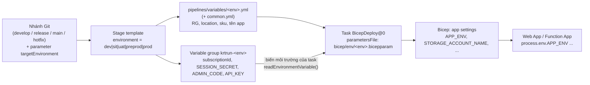
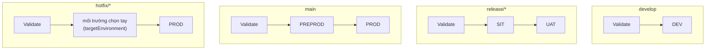

# KRT-run (repo `infra`) – Hướng dẫn

Repo này chứa **hạ tầng Azure** bằng **Bicep** và pipeline **provision** (Azure DevOps): VNet, App Service Plan + Web App (Node 22), Function App (Consumption), Storage (Blob/Queue/Table), APIM Consumption, App Insights (tuỳ chọn). Code ứng dụng và pipeline app-deploy nằm ở repo riêng `app`.

```
infra/
├── AGENTS.md
├── .cursor/rules/bicep.mdc
├── bicep/
│   ├── main.bicep
│   ├── modules/           # network, storage, web, function, roles, apim, insights
│   └── env/               # dev|sit|uat|preprod|prod.bicepparam
├── pipelines/             # provision.yml, templates/, variables/<env>.yml
└── docs/SETUP_vi.md
```

Kiểm tra cú pháp (không deploy):
```bash
az bicep build --file bicep/main.bicep --stdout > /dev/null
for e in dev sit uat preprod prod; do az bicep build-params --file bicep/env/$e.bicepparam --stdout > /dev/null; done
```

### Biến môi trường mà Bicep ghi vào app settings

| Biến | Ý nghĩa | Nguồn |
|---|---|---|
| `APP_ENV` | Tên môi trường | param `environment` |
| `STORAGE_ACCOUNT_NAME` | Tên storage (dùng managed identity) | output module storage |
| `QUEUE_NAME`, `BLOB_CONTAINER_INCOMING/PROOFS`, `TABLE_USERS/RUNS/AUDIT` | Tên queue/container/table | param + giá trị mặc định |
| `SESSION_SECRET`, `ADMIN_CODE`, `API_KEY` | **Secret** | biến môi trường của pipeline (variable group `krtrun-<env>`) |

---

## 1. Biến chảy qua từng tầng như thế nào (phần hạ tầng)



Giải thích dễ hiểu (giống việc **gọi món ăn**):
1. **Nhánh Git** là "bàn nào gọi món". Pipeline nhìn tên nhánh để biết phải chạy môi trường nào (hotfix thì bạn chọn tay bằng `targetEnvironment`).
2. Mỗi stage mang tên môi trường, rồi **tự nạp file `pipelines/variables/<env>.yml`** của đúng môi trường đó (tên resource group, region, SKU, tên web app...). Phần dùng chung nằm ở `common.yml`.
3. **Secret không nằm trong repo.** Chúng nằm trong *variable group* `krtrun-<env>` trên Azure DevOps. Task chuyển chúng thành biến môi trường, file `.bicepparam` đọc bằng `readEnvironmentVariable('SESSION_SECRET', '')`.
4. Pipeline dùng task có sẵn `BicepDeploy@0` (what-if rồi deploy) với file `bicep/env/<env>.bicepparam`; mọi giá trị tham số nằm trong file này. File `pipelines/variables/<env>.yml` chỉ giữ tên resource group, region, tên web app... để pipeline dùng, nên phải khớp với bicepparam.
5. Bicep ghi các giá trị đó vào **app settings** của Web App và Function App.
6. Khi chạy, Azure đưa app settings vào **`process.env`**, và `config.js` đọc ra.

> **Lưu ý quan trọng:** `sit`, `uat`, `preprod` dùng **chung tài nguyên của dev** (cùng RG, web app, storage). Mỗi lần provision môi trường nào thì `APP_ENV` của web app dev bị đổi thành tên môi trường đó (bản provision cuối cùng thắng). Đây là cách tiết kiệm tiền khi đang học. Khi cần tách thật, đổi `resourceEnv` và tên trong `pipelines/variables/<env>.yml` + `bicep/env/<env>.bicepparam`.

---

## 2. Nhánh Git → môi trường



| Nhánh | Các stage chạy (tuần tự) | Approval |
|---|---|---|
| `develop` | Validate → **DEV** | không |
| `release/*` | Validate → **SIT** → **UAT** | UAT |
| `main` | Validate → **PREPROD** → **PROD** | PREPROD, PROD |
| `hotfix/*` | Validate → **targetEnvironment** (dev/sit/uat/preprod, mặc định dev) → **PROD** | môi trường uat/preprod nếu chọn, và PROD |

Pipeline `pipelines/provision.yml` của repo này theo quy tắc trên (pipeline app-deploy ở repo `app` có quy tắc giống hệt). Stage đầu là **Validate** (bicep build + build-params, không cần kết nối Azure). Stage deploy là *template* dùng lại: `pipelines/templates/deploy-infra.yml` (what-if + deploy) và `pipelines/templates/validate-bicep.yml`.
Approval **không** nằm trong YAML: bạn vào Azure DevOps → Pipelines → Environments → `krtrun-<env>` → Approvals and checks.

---

## 3. Thiết lập Azure DevOps cho repo infra (làm một lần)

1. **Tạo repo `infra` trên Azure DevOps** rồi đẩy code:
   ```bash
   cd infra
   git remote add origin <URL repo infra>
   git add . && git commit -m "init KRT-run infra"
   git branch -M main && git push -u origin main
   git checkout -b develop && git push -u origin develop
   ```
   (Repo này đã `git init -b develop`, chưa có commit.)
2. **Service connection** (Project settings → Service connections → *Azure Resource Manager* → **Workload identity federation**): `sc-krtrun-dev` (cho dev/sit/uat/preprod) và `sc-krtrun-prod` (cho prod). Tên phải khớp `serviceConnection` trong `pipelines/variables/<env>.yml`. Cần quyền **Contributor** và **User Access Administrator** (hoặc Owner) vì Bicep tạo *role assignment* cho managed identity và pipeline tạo resource group.
3. **Environments**: `krtrun-dev`, `krtrun-sit`, `krtrun-uat`, `krtrun-preprod`, `krtrun-prod`; thêm **Approvals** cho `uat`, `preprod`, `prod`.
4. **Variable groups** (Pipelines → Library): `krtrun-dev`, `krtrun-sit`, `krtrun-uat`, `krtrun-preprod`, `krtrun-prod`; mỗi group có 1 biến thường `subscriptionId` (Subscription ID của Azure, dạng GUID) và 3 biến secret (bấm biểu tượng khoá):
   - `SESSION_SECRET` (ví dụ `openssl rand -hex 32`), `ADMIN_CODE` (mã nhân viên của bạn), `API_KEY` (chuỗi ngẫu nhiên).
5. **Tạo pipeline** `krtrun-provision` → `/pipelines/provision.yml`.
6. **Đổi giá trị thật**: `publisherEmail` trong `bicep/env/*.bicepparam`; `prefix` nếu tên `krtrun-dev-web` bị trùng toàn cầu (đổi ở cả `pipelines/variables/*.yml` + `bicep/env/*.bicepparam` **và** `pipelines/variables/*.yml` của repo `app`).
7. **Chạy**: merge vào `develop` → Validate → what-if → (approve) → deploy DEV. Sau đó mới chạy `app-deploy` ở repo `app`.
8. **Hotfix**: nhánh `hotfix/xxx` từ `main`, **Run pipeline** chọn nhánh và `targetEnvironment`.

Đọc kết quả what-if trước khi bấm Approve.

---

## 4. Chi phí (tham khảo, 1 USD ≈ 25.500đ, giá có thể đổi)

| Thành phần | SKU | Chi phí/tháng |
|---|---|---|
| App Service Plan (dev/sit/uat/preprod chung) | **F1** | 0đ |
| Function App | Consumption Y1 (1 triệu lần chạy miễn phí) | ~0đ |
| Storage (Blob + Queue + Table) | Standard LRS | vài nghìn đồng |
| VNet + 2 subnet | – | 0đ |
| APIM | Consumption (1 triệu call miễn phí) | ~0đ |
| Application Insights | tắt mặc định (`enableInsights=false`) | 0đ |
| **Tổng bộ dev** | | **< 200k** |
| Prod: App Service Plan | **B1** (~13 USD) | ~330k |

⚠️ Nếu bật thêm bộ **prod** với B1 thì tổng sẽ vượt 200k. Khi đang học hãy **không chạy stage PROD**, hoặc sửa `appServicePlanSku` của prod về `F1` trong `env/prod.bicepparam`.

F1 + Node.js: giới hạn khoảng 60 phút CPU/ngày, 1GB RAM, không có Always On (app "ngủ" sau một lúc không dùng, request đầu tiên chậm). Đủ cho demo; nếu app bị dừng vì hết quota CPU thì nâng lên B1.

## 5. Dọn dẹp (tránh tốn tiền)

**Cách 1 – pipeline `pipelines/destroy.yml`** (chỉ chạy tay, không tự trigger):
1. Tạo pipeline `krtrun-destroy` trỏ `/pipelines/destroy.yml`, rồi **Run pipeline** và chọn `environment` (mặc định `dev`).
2. Pipeline dừng ở approval của environment `krtrun-<env>`. **Bạn bấm Approve thì mới xoá**, không Approve thì không xoá gì (đây là chốt an toàn duy nhất).
3. Khi chạy: xoá APIM trước, **purge** bản soft-delete để hôm sau tạo lại không bị trùng tên, rồi xoá resource group.

⚠️ `dev` dùng chung cho sit/uat/preprod nên xoá `dev` là mất cả bộ.

**Cách 2 – chạy tay bằng lệnh:**
```bash
az group delete --name rg-krtrun-dev --yes --no-wait
az apim deletedservice purge --service-name krtrun-dev-apim --location australiaeast   # nếu có APIM
```
Lệnh này **xoá toàn bộ** tài nguyên trong group, hãy chắc chắn trước khi chạy.

**Chi phí theo ngày:** App Service B1 Linux ở `australiaeast` khoảng 0,019 USD/giờ, tức ~5k VND cho 10 giờ dùng. Mẹo: dựng lên, làm xong thì chạy destroy trong ngày. Gói F1 thì không tốn.

## 6. Lưu ý cho bài thứ 3 (tách FE / BE)

- **F1 không có VNet integration.** Code Bicep tự bỏ qua VNet khi SKU là F1/D1. Muốn BE tích hợp VNet phải dùng **B1** trở lên (~13 USD/tháng). Mẹo: chỉ nâng lên B1 lúc demo rồi hạ về F1 hoặc xoá.
- **APIM Consumption không nối vào VNet được.** Muốn APIM vào VNet phải dùng Developer (~50 USD) hoặc Standard v2, đều vượt 200k.
- Function App Consumption (Y1) cũng không có VNet integration.
- Static Web Apps (Free) cho FE, BE đặt sau APIM: khi đó `API_KEY` nên đặt bằng policy `set-header` trong APIM thay vì để lộ ở FE.

## 7. Giới hạn hiện tại (nên biết)

- Session lưu trong bộ nhớ (MemoryStore): chỉ ổn với **1 instance**; restart là đăng nhập lại. Nhiều instance thì đổi sang store ngoài.
- Chưa có giới hạn số lần đăng nhập sai (rate limit).
- `SESSION_SECRET`, `ADMIN_CODE`, `API_KEY` hiện đặt thành *app setting*. Muốn an toàn hơn thì chuyển sang Key Vault reference.
- Bicep và pipeline **chưa được chạy thật trên Azure** (chỉ build/validate cú pháp).
- Linux Consumption (Y1) của Function có lộ trình ngừng hỗ trợ trong tương lai; xem docs Azure khi triển khai lâu dài.

## 8. Từ khó

| Từ | Nghĩa |
|---|---|
| Bicep | Ngôn ngữ viết hạ tầng Azure bằng code (dễ đọc hơn JSON ARM) |
| `.bicepparam` | File chứa giá trị tham số cho Bicep, mỗi môi trường một file |
| Managed identity | "Căn cước" tự động của app để truy cập Azure mà không cần mật khẩu |
| Audit log | Nhật ký ghi lại ai làm gì, chỉ thêm, không sửa |
| What-if | Xem trước Azure sẽ thay đổi gì mà chưa thật sự deploy |
| Service connection | Kết nối cho phép pipeline đăng nhập vào Azure |
| Workload identity federation | Cách service connection đăng nhập không cần lưu mật khẩu/secret |
| Environment (Azure DevOps) | Nơi gắn approval, pipeline phải chờ duyệt trước khi deploy |
| Variable group | Nhóm biến (có thể là secret) dùng chung cho nhiều pipeline |
| Stage / Job / Template | Giai đoạn / công việc / khuôn dùng lại trong pipeline |
| APIM | API Management: cổng đứng trước API, quản lý key, giới hạn, chính sách |
| SKU | Gói dịch vụ (F1 miễn phí, B1 trả phí...) |
| Append-only | Chỉ được thêm bản ghi mới, không sửa/xoá |
